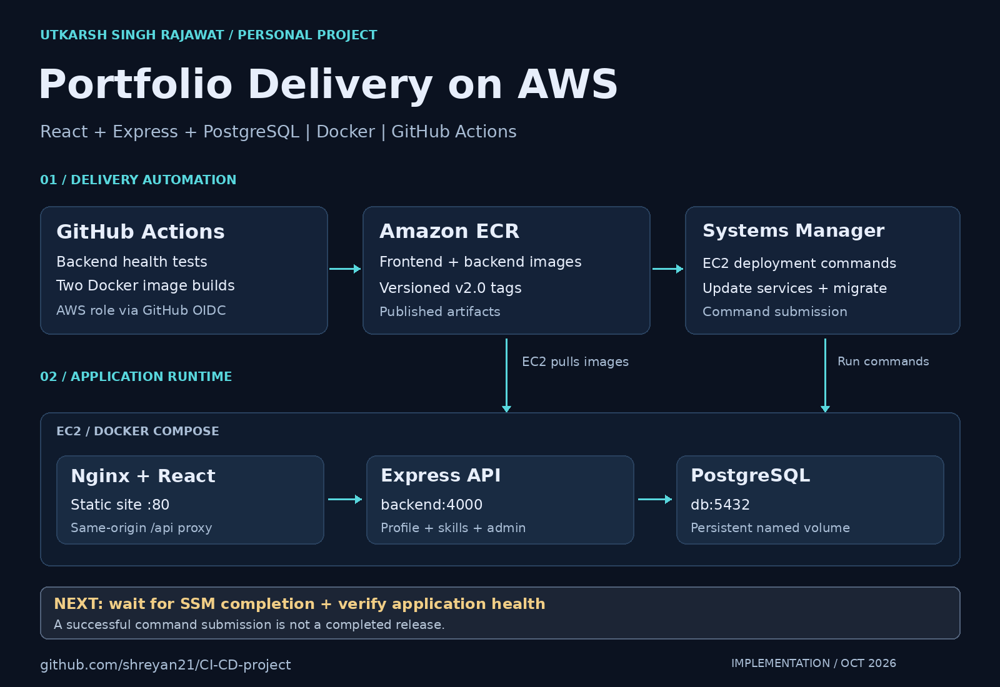
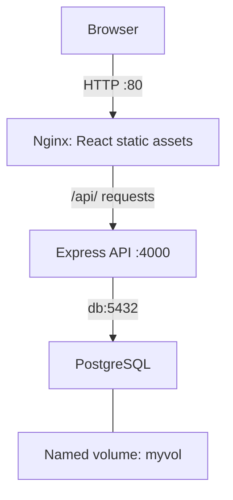

# Portfolio Delivery on AWS

**A personal portfolio that also demonstrates how I package, test and release an application.**

I built a React, Express and PostgreSQL portfolio, containerized it with Docker Compose, and added GitHub Actions to test the API, build two images, publish them to Amazon ECR and send deployment commands to EC2 through AWS Systems Manager. The frontend uses a multi-stage Docker build and Nginx to serve React and proxy API requests.

[](https://github.com/shreyan21/CI-CD-project/actions/workflows/ci.yml)

[Inspect a successful run](https://github.com/shreyan21/CI-CD-project/actions/runs/40129948952) | [Read the workflow](.github/workflows/ci.yml) | [Run locally](#run-locally) | [Deployment notes](docs/deployment.md) | [Evidence](docs/evidence.md)



## What this project demonstrates

- **Application delivery:** one personally built product, two application images and a persistent PostgreSQL database.
- **Container networking:** Nginx forwards browser requests from `/api/` to `backend:4000`; Express connects to `db:5432`.
- **AWS authentication:** GitHub OIDC assumes an IAM role for the workflow; no long-lived AWS access-key inputs are configured in the workflow.
- **Automation:** a push to `master` runs three backend health tests, builds both images, publishes to ECR and submits an SSM command to update EC2 containers and run migrations.
- **Troubleshooting:** the health endpoint checks the database; its tests cover success, failure and recovery. The UI marks fallback data when live API requests fail.

**Evidence boundary:** the linked Actions run verifies tests, both image pushes and SSM command submission. Its final SSM status is `Pending`; this workflow does not yet wait for remote completion or run a post-deployment health check. A green badge alone is not proof of a healthy release. See the [evidence record](docs/evidence.md).

## Application architecture



The public page reads profile, skills, experience and certifications through the API. An admin UI manages skills using password hashes, database-backed sessions, HTTP-only cookies and CSRF checks. These controls are implemented in code; this is not a security-audited service.

| Component | Current implementation |
| --- | --- |
| Frontend | React + Vite; static build served by Nginx; SPA routing and `/api/` reverse proxy |
| API | Node.js + Express; validation, request limits, PostgreSQL queries and `/health` |
| Data | Four versioned migrations, guarded/conflict-safe seed inserts, named Docker volume |
| CI/CD | GitHub Actions on `master`; backend tests, image builds, ECR publishing, SSM command submission |
| AWS | ECR image registry; deployment target is an existing EC2 host with SSM |

## Run locally

Requirements: Git, Docker with Compose v2, and a Bash-compatible terminal. Node.js 24 is needed only for commands run outside containers.

### 1. Configure a fresh checkout

```bash
git clone https://github.com/shreyan21/CI-CD-project.git
cd CI-CD-project
cp .env.example .env
cp backend/.env.example backend/.env
cp frontend/.env.example frontend/.env
```

Choose a local `POSTGRES_PASSWORD` in the root `.env` and use the same password in `backend/.env`'s `DATABASE_URL`. The examples match for local demonstration; replace the example password. Generate a session secret and paste it into `backend/.env`:

```bash
docker run --rm node:24-trixie node -e "console.log(require('node:crypto').randomBytes(48).toString('base64url'))"
```

`FRONTEND_ORIGIN=http://localhost` matches the Compose site. The frontend currently uses `/api` directly in [`api.js`](frontend/src/lib/api.js); `VITE_API_URL` is not read. Keep local `.env` files out of Git.

**Existing database:** changing `POSTGRES_PASSWORD` in Compose does not change the password inside an initialized PostgreSQL volume. Preserve your existing credentials when updating an existing setup. Do not delete the volume to resolve a password mismatch.

### 2. Build and initialize

```bash
docker compose build
docker compose up -d db
docker compose exec db sh -c 'pg_isready -U "$POSTGRES_USER" -d "$POSTGRES_DB"'
```

Wait until PostgreSQL reports it is accepting connections, then:

```bash
docker compose run --rm --no-deps backend npm run db:init
docker compose up -d backend frontend
bash scripts/healthcheck.sh http://localhost
curl --fail http://localhost:4000/health
```

`db:init` applies migrations and initial seed data. Subsequent schema updates can use `docker compose exec backend npm run db:migrate` without reseeding.

| Local URL | Purpose |
| --- | --- |
| `http://localhost` | Portfolio served by Nginx |
| `http://localhost/admin` | Skills admin UI |
| `http://localhost/api/skills` | API through the reverse proxy |
| `http://localhost:4000/health` | API + database check directly on Express |

Nginx currently proxies `/api/`, not `/health`; use port 4000 for the health endpoint. Open port 80 must be available on your machine.

### 3. Optional admin setup and shutdown

```bash
docker compose exec backend npm run auth:reset -- admin
docker compose logs --tail=100 backend
docker compose down
```

The admin command prompts for a password and stores a hash in PostgreSQL. `docker compose down` retains the named volume. Adding `--volumes` deletes its data. Local HTTP is for demonstration; use HTTPS before sending admin credentials over a public connection.

## Tests and builds

```bash
npm --prefix backend ci
npm --prefix backend test
npm --prefix frontend ci
npm --prefix frontend run build
```

The three checked-in tests use a stubbed database to verify `/health`: a successful query, a database failure without leaked error details, and recovery after failure. They do not prove a real PostgreSQL integration. The `test:integration` command currently points to a missing test file.

The frontend build also runs inside its Dockerfile during CI. The backend Dockerfile still starts Node in watch mode. CI uses Node 20, the backend container uses Node 24 and the frontend builder uses `node:latest`; version alignment remains a follow-up.

## Repository guide

| Path | Responsibility |
| --- | --- |
| [`frontend/`](frontend/) | React UI, admin panel, multi-stage image, Nginx configuration |
| [`backend/`](backend/) | Express API, authentication, migrations, seed data, health tests |
| [`docker-compose.yml`](docker-compose.yml) | Local three-service stack and persistent database volume |
| [`.github/workflows/ci.yml`](.github/workflows/ci.yml) | Test, build, publish and SSM command workflow |
| [`scripts/healthcheck.sh`](scripts/healthcheck.sh) | Homepage and API smoke checks; currently run manually |
| [`docs/deployment.md`](docs/deployment.md) | AWS flow, required configuration and deployment limits |
| [`docs/evidence.md`](docs/evidence.md) | Verifiable run, image digests and claim boundaries |
| [`docs/showcase.md`](docs/showcase.md) | Project description, LinkedIn draft and demonstration outline |

## Next engineering improvements

1. Wait for the SSM result, fail Actions on remote failure and verify the homepage and database-backed API after deployment.
2. Publish immutable commit-SHA image tags and retain a tested rollback target; current `v2.0` tags are reused.
3. Restrict database/API exposure, pin runtime/database versions, align Node versions and use HTTPS.
4. Add real PostgreSQL integration coverage and pull-request checks.
5. Extend this same project with Terraform, monitoring, tested rollback and backup/restore evidence.

This is a personal learning project on a single EC2 host, not a highly available service. AWS resources can incur ongoing charges. Environment files have been removed from the current source tree; any real credentials previously committed must still be rotated because Git history retains them.

---

**Utkarsh Singh Rajawat** | [LinkedIn](https://linkedin.com/in/utkarsh-singh-rajawat) | [GitHub](https://github.com/shreyan21)
